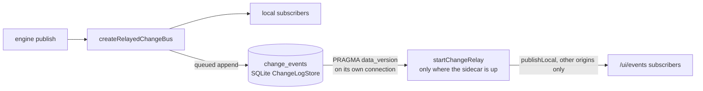

# ADR-036: Live update across processes

**Status:** Accepted · **Date:** 2026-11-14 · **Deciders:** Rafael · **Revises ADR-027 §3** (the "known limit":
live update reaches only browsers served by the process that wrote).

## Context

ADR-027 §3 made dashboards refresh themselves: after `runEffects` commits, the change bus publishes the entity tags
of the batch, and `GET /ui/events` forwards them to the open dashboard, which refetches the sections those tags
feed. The bus is in-process (`createChangeBus` from `@rfc0/effect-runner`), and ADR-027 accepted that a write from
another process would not reach the dashboard, expecting multi-client use to go through one HTTP server (ADR-024).

That expectation does not hold. Every MCP client starts its own stdio server, and Claude Desktop alone starts two
(observed 2026-11-13: two `npx -y @rfc0/patty@latest` processes under the app's helper). All of them open the same
database; only the first binds the dashboard port (`HTTP sidecar disabled — port 51737 is already in use` for the
others). A write made through any other process commits, but the process serving the dashboard never hears of it,
so the dashboard does not refresh. It looks random to the person: it depends on which process the chat happens to
use and which started first.

`@rfc0/effect-runner` anticipated this. Its ADR 0002 §3: `createChangeBus` is process-local, and "a deployment
spanning processes implements `ChangeBus` over its own transport and hands its `publish` to the engine; the engine
does not change".

## Decision

### 1. The database is the transport

The processes share exactly one thing: the database file. A small table carries change notifications between them:

- `change_events`: `id` (integer, autoincrement), `user_id` (nullable, the `ChangeEvent.userId`), `entities` (JSON
  array of entity tags), `origin` (the writing process's id), `created_at`.
- It holds **only entity tags**, never data, so it reveals nothing beyond "user X changed something of kind Y".
- It is an infrastructure table, not an owned domain table: no repo in `Deps`, no controller ever reads it, no
  applier, not in `Tenancy`. Only the composition-root relay below reads and writes it. The tenancy map in
  `docs/architecture.md` lists it as such, so the isolation suite's "every owned table" rule does not apply.
- A new migration creates it. It rewrites no data, so it is not in `DATA_REWRITING_MIGRATIONS`.

### 2. Writing: a `ChangeBus` that also appends

The bus is `@rfc0/effect-runner`'s `createRelayedChangeBus` (its ADR 0003); PATTY provides the SQLite `ChangeLogStore`,
the policy values and the wiring. What it does:

`composition/` builds the runtime's bus as a `ChangeBus<ChangeEvent>` whose `publish`:

1. publishes locally first (`createChangeBus`, unchanged), so a browser on the same process still updates at once;
2. then appends one `change_events` row with this process's `origin` id.

The append happens after the commit, as a separate best-effort write. A failure (busy database, closed connection)
goes to the bus's `onError` and never fails the write that triggered it; the cost of a lost row is one missed
refresh, which the next navigation or the resync in §4 repairs. The write must not wait long for a lock: it uses a
short, named timeout, not the database's normal `busy_timeout`.

Every process appends, whether or not it serves a dashboard: it cannot know whether another process does.

`@rfc0/effect-runner` does not change for this decision; its 0.6.0 release later took the generic mechanics (§2 and §3)
into the package. PATTY keeps only what is its own: the store, the policy values and the wiring at the composition
root.

### 3. Reading: a relay in each process that serves the dashboard

The relay is `@rfc0/effect-runner`'s `startChangeRelay` (its ADR 0003); PATTY supplies the store, the intervals and
starts it only where a dashboard is served. A process whose HTTP sidecar is up (or that runs the HTTP transport) runs it:

- It starts from the current `MAX(id)`, so it never replays old changes.
- Every `CHANGE_RELAY_POLL_MS` (about one second) it first checks SQLite's `PRAGMA data_version`, which changes only
  when another connection committed. Unchanged: nothing else runs. Changed: it reads rows with `id` above the last
  seen, `origin` different from its own, in `id` order, with a row limit.
- Each row is decoded with zod at this boundary (a row that does not decode is skipped and reported) and published
  on the local bus only (never appended again, so rows do not echo between processes).
- `/ui/events` is unchanged: it already filters each event by the stream's user and `SHARED_ENTITY_TAGS`.

A process without a sidecar (`PATTY_HTTP=false`, or the port was taken) runs no relay; since only the relay prunes on
an interval, every process also prunes once when it starts, so a relay-less process's rows are gone by the next start
of any process (a long-lived one keeps only its own session's rows meanwhile).

The package's side of this (the append queue, the relay loop, the echo and isolation guarantees) is in effect-runner's
ADR 0003 diagrams.

### 4. Retention and resync

- Rows older than `CHANGE_EVENT_RETENTION_MS` (ten minutes) are deleted by the relay, on its own interval. The
  table stays a few rows long.
- A dashboard that reconnects its stream after a gap may have missed events. The shell then sends the open
  dashboard one resync (every entity tag it listens for), which costs one refetch. This also covers a relay that
  started after a write it never saw.

### 5. Ordering and latency

Changes from the same process arrive in order; across processes, in commit order of the append, which is close
enough for a refresh signal. A cross-process change reaches the dashboard within about one poll interval. Same-process
changes stay immediate. A process's own writes also move its relay's `data_version`, which costs one read per write
that finds only its own (excluded) rows.

## Options considered

- **`PRAGMA data_version` alone, refreshing everything on any change.** No table, but no user and no entity tags:
  every open dashboard of every user refetches everything on any commit. Kept as the relay's cheap first check.
- **Client-side polling of the API.** Heavier (every dashboard refetches on a timer), slower, and duplicated in
  every dashboard. Rejected.
- **One server for all clients** (stdio processes forward to whichever process holds the port). Correct in
  principle, but the app decides how many processes it starts, and forwarding MCP between processes is a much
  larger change with its own failure modes. Rejected for now; nothing here prevents it later.
- **Inter-process sockets or a broker.** Discovery, cleanup and a moving part for a local-first app whose processes
  already share a database. Rejected.
- **Watching the database or WAL file.** File-change notifications are unreliable across platforms and say nothing
  about what changed. Rejected.
- **Appending inside the write's own transaction.** Atomic, but the change set is known only after the batch
  applied (idempotent duplicates publish nothing), and it would mean changing every flow or the engine. Rejected;
  a lost notification is cheap.

## Consequences

- Dashboards refresh after a write from any process: any chat, Claude Code, the CLI.
- One extra small write after each committing batch, and one cheap pragma per second per serving process.
- A new infrastructure table that domain code never touches.
- ADR-027 §3's known limit is removed; `docs/ui.md` and `docs/architecture.md` drop it.

## Plan

1. [x] `fix/dashboard-live-update-gaps` (#249), independent of this ADR: `cards` listens for `bill`, `projections` for
       `account`, each bundled dashboard's tag list checked by a test; the shell recovers a closed event stream
       (login on 401, reconnect otherwise) and resyncs after a reconnect (§4).
2. [x] `feat/cross-process-live-update` (#251): the table and migration, the SQLite `ChangeLogStore`, the wiring over
       `@rfc0/effect-runner` 0.6's relayed bus and relay, retention, tests across two runtimes on one database, docs. One adjustment to §3: `PRAGMA data_version` is per connection and
       libsql replaces a client's connection after every transaction, so the relay (and the appender) read and write on a
       sibling connection of their own (`diplomat/db/driver.ts`'s `openSibling`), which never runs a transaction; the
       first tick always reads past the cursor, so a commit between reading the newest id and the first version
       reading is never absorbed into a baseline.
