# Authentication flows (ADR-033 Phases 1, 2 and 4, ADR-034 steps 1–2)

These diagrams show the flows as built: who takes part in each one and what happens at each step.
The operator guide is [`auth.md`](auth.md); the decision record is
[`adr/033-authentication-and-multi-user.md`](adr/033-authentication-and-multi-user.md) and
[`adr/034-local-auth-and-stdio-sign-in.md`](adr/034-local-auth-and-stdio-sign-in.md).

**Participants** (each name matches a source file):

| Participant | Where | Role |
|---|---|---|
| Config | `src/config.ts` | Reads `FINTRACK_AUTH` (default `required`) and refuses `disabled` on an exposed instance (`HOST` / `PUBLIC_URL` / `TRUST_PROXY`) |
| VersionGuard | `src/diplomat/db/version-guard.ts` (rule: `src/logic/migration.ts`) | First thing `bootstrap` does: refuses a database a newer build has migrated, before anything is copied, migrated, seeded or written |
| Bootstrap | `src/diplomat/db/bootstrap.ts`, `safety-copy.ts`, `migration-journal.ts`, `migration-lock.ts` | Migrations, the owner row, the pre-migration backup |
| AuthRuntime | `src/composition/auth.ts` | Builds the identity deps (shared with the CLI and the stdio session), prunes sessions and expired sign-in requests, issues and prints the setup code |
| Cli | `src/diplomat/cli/commands.ts` (router), `commands/{auth,login,setup,users}.ts` (handlers), `io.ts`, `messages.ts`, `prompt.ts`, `terminal.ts`; composed in `src/composition/cli.ts` | `fintrack setup [client]`, `auth setup`, `auth reset-password`, `login`, `logout`, `users list|invite|reissue|disable|enable|role`: opens the database like the server (no stdio), prompts with no echo, runs the controller flows or the sign-in protocol through the injected interpreter, prints what the protocol presents; an unknown command prints the usage and exits non-zero |
| SignInServer | `src/composition/sign-in/server.ts` | Where `login` sends the browser — and a stdio session whose sidecar names no page: always a temporary loopback app of the asking process, on a free port, for the length of the request |
| ClientConfig | `src/diplomat/client-config/{merge,clients}.ts` | The MCP clients' own config files `setup` writes (Claude Code, Claude Desktop, VS Code, Antigravity, Codex): pure merge helpers, file reads and writes |
| SignInFlow | `src/logic/auth/sign-in-flow.ts` (data: `src/models/auth/sign-in-flow.ts`) | The sign-in protocol as a pure state machine, `nextStep(state, observation, config)` → new state + effects: every rule of a stdio sign-in and of `login`, decided once (diagram 11) |
| SignInInterpreter | `src/composition/sign-in/interpreter.ts`, built by `sign-in/wiring.ts`'s `createSignInFor` (port: `SignInInterpreter` in `src/controllers/deps.ts`) | The one executor of those effects — through `startGrant`, `redeemGrant`, `authenticateToken`, `revokeSignInByHash`, the keychain store and a page — built at the composition root and injected into both edges; it executes and reports, it decides nothing |
| StdioSession | `src/diplomat/mcp/stdio-session.ts`, `gate.ts`, `scopes.ts` | The stdio channel's identity edge: feeds one observation per gated request (and per poll tick) to the interpreter, keeps the state, runs the poll timer while a request is open, and turns what the protocol said into the answer; the scope guard asks it who is calling |
| SignInStore | `src/diplomat/auth/sign-in-store.ts` | The OS keychain entry `signin:<profile>:<dbId>` of a saved sign-in |
| AuthHook | `src/diplomat/http/hooks/auth.ts` — `registerAuthHook` (decisions in `src/logic/auth/{origin,bearer,scope,token}.ts`) | The `onRequest` hook: the loopback Host/Origin guard (auth disabled), the public allowlist, credential precedence (bearer vs. cookie), session/token resolution, the CSRF check, the route-scope check, challenges and redirects |
| Bearer | `src/diplomat/http/bearer.ts` | Builds the `WWW-Authenticate` response (`logic/auth/bearer.ts`'s `bearerChallenge`; only the origin is resolved at the edge) — shared by the hook and the MCP route |
| AuthRoutes | `src/diplomat/http/routes/auth.ts` | `/ui/setup`, `/ui/login`, `/ui/logout`: form parsing, rate limiting, cookies |
| UserRoutes | `src/diplomat/http/routes/users.ts` (pages: `user-pages.ts`) | `/ui/access/users` and its form posts: the admin-only, session-only user management; `requireAdmin` answers a non-admin with the framework's own not-found reply |
| InviteRoutes | `src/diplomat/http/routes/invite.ts` | `/ui/access/invite`: where an invited person claims an invite - public like `/ui/setup`, `Referrer-Policy: strict-origin`, rate-limited per address and per code |
| TokenRoutes | `src/diplomat/http/routes/tokens.ts` | `/ui/access/tokens`, `/ui/access/tokens/:id/revoke`: session-only token pages (personal access tokens and stdio sign-ins) |
| ConnectRoutes | `src/diplomat/http/routes/connect.ts` | `/ui/connect`: the session-only consent page for a stdio / `login` sign-in; throttles failed code lookups |
| WellKnown | `src/diplomat/http/routes/well-known.ts` | The two Protected Resource Metadata (RFC 9728) routes |
| McpRoute | `src/diplomat/mcp/route.ts`, `scopes.ts` | `POST /mcp`: per-tool scope pre-check on the JSON-RPC body, `req.auth` for the transport, per-tool re-check |
| Controller | `src/controllers/auth.ts`, `access-tokens.ts`, `grants.ts` | `issueSetupCode`, `claimOwner`, `claimOwnerLocally`, `resetPassword`, `login`, `logout`, `authenticate`; `createToken`, `listTokens`, `revokeToken`, `revokeSignInByHash`, `authenticateToken`; `startGrant`, `findConsent`, `approveGrant`, `denyGrant`, `redeemGrant`, `pruneExpiredGrants`; `controllers/users.ts`: `listUsers`, `inviteUser`, `reissueInvite`, `claimInvite`, `disableUser`, `enableUser`, `setRole`, `setSignInCap`; returns `{ persist, response }` |
| Logic | `src/logic/auth/*.ts` — `owner`, `password`, `session`, `token`, `scope`, `bearer`, `origin`, `grant`, `keychain`, `signInFlow`, `message`, `users`, `revoke`, `redact` | Pure rules: expiry, the sliding window, "can log in", origin comparison, scopes, the token verdict, credential parsing, challenges, the metadata document; the grant transitions, `signInExpiry`, the consent pre-selection and the instance cap (`clampToCap`, `offeredDurations`), `redeemPlan`, the not-signed-in message, and the sign-in protocol; user status, the admin gate and the guard tables (`authorizeActor`, `guardAdminChange`), the credentials a disable ends (`endingCredentials`), and what may not reach a log (`redactSecretQuery`) |
| Secrets | `src/diplomat/auth/credentials.ts` | argon2id, CSPRNG session tokens, access tokens (`ftk_…`), setup / invite / user / device codes, sha256 |
| Runner | `@rfc0/effect-runner` via `runEffects` | Applies the persistables in one transaction (optimistic versions, retries) |
| DB | `users`, `sessions`, `setup_codes`, `access_tokens`, `client_grants`, `invites`, `settings` | Stores only hashes, never a token or code in plaintext |

---

## 1. Startup: which mode, the owner row, and the setup code

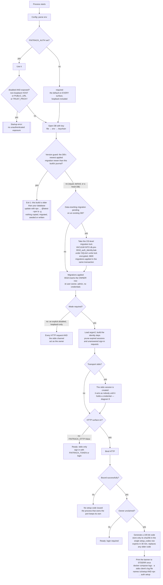

## 2. First-time setup: claiming the owner

## 2b. First setup from the terminal

`fintrack setup <client>` and `fintrack auth setup` (ADR-034 §5). The CLI is a process of its own: it opens the database
with the same key resolution and migrations as the server, but starts neither HTTP nor stdio. Nothing here is typed into a
chat, and no sign-in link or setup code is involved.

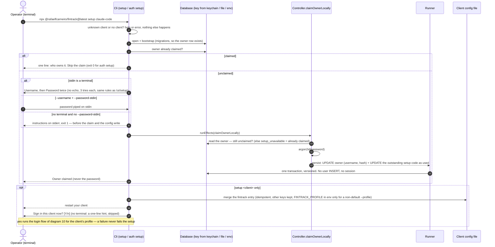

### Reset a password

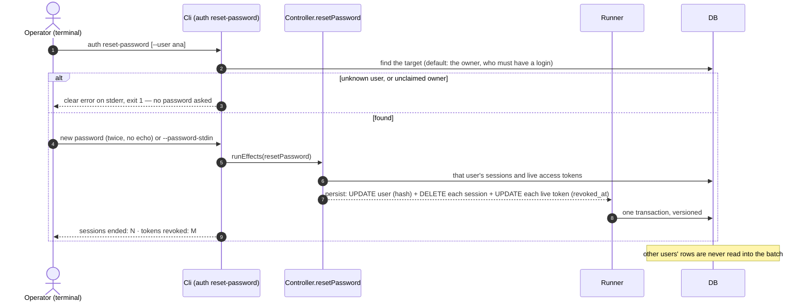

## 3. Login

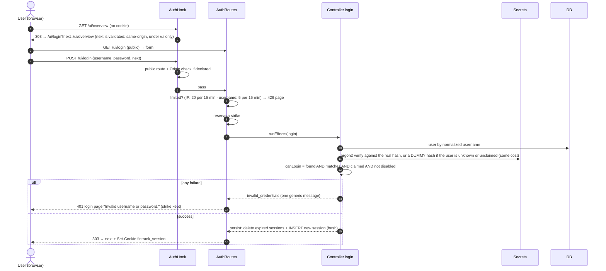

## 4. Every authenticated request (the auth hook)

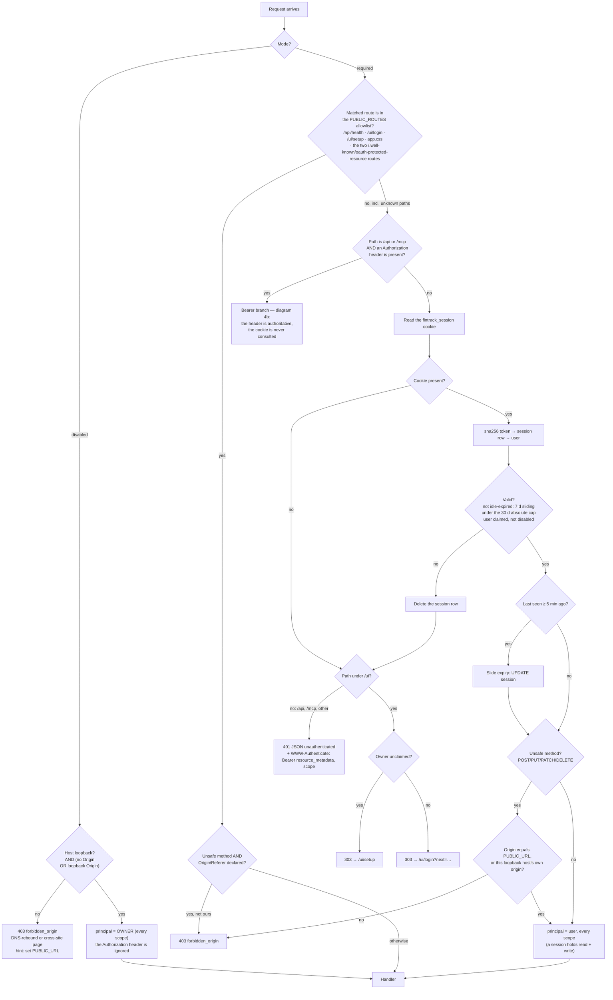

## 4b. Bearer token request (REST / MCP)

Precedence → verify → scope → handler / 401 / 403. A bearer carries no ambient credential, so there is **no CSRF check**.
`/ui` never takes this path: a bearer there is "no credential" and gets the login redirect.

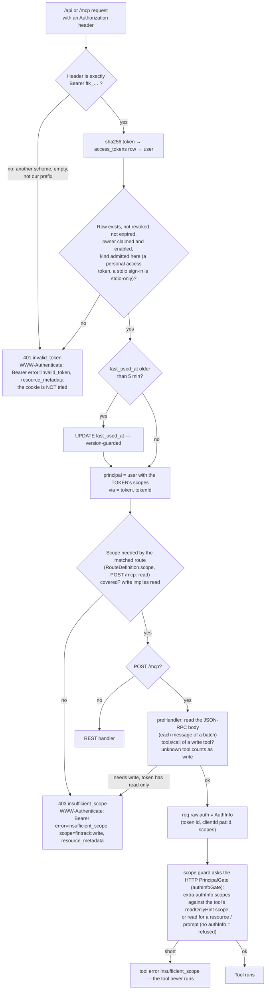

## 4c. Create / revoke a token

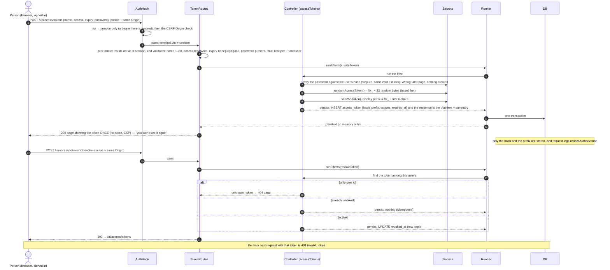

## 5. Logout and live dashboards (SSE)

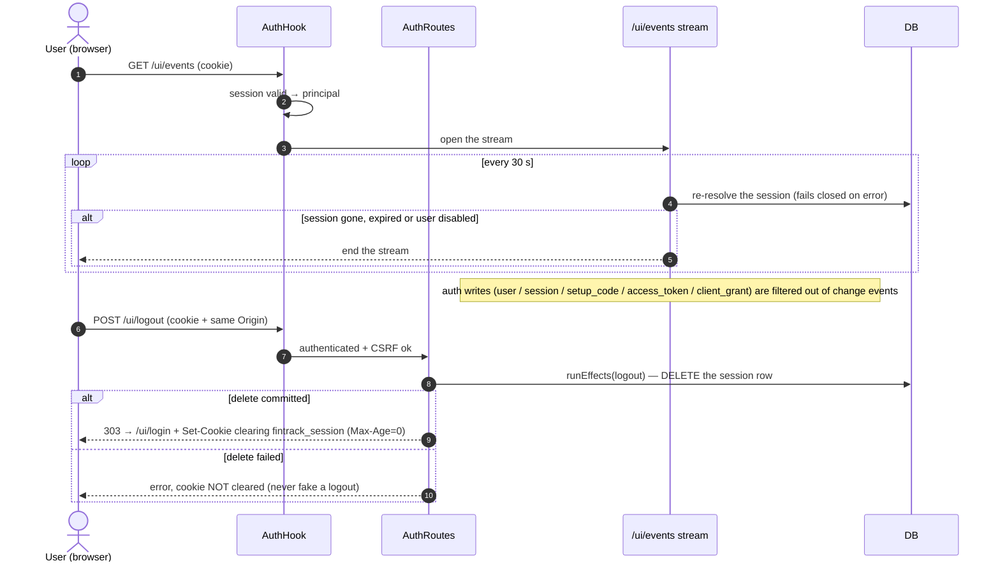

## 6. Who acts as whom, per transport

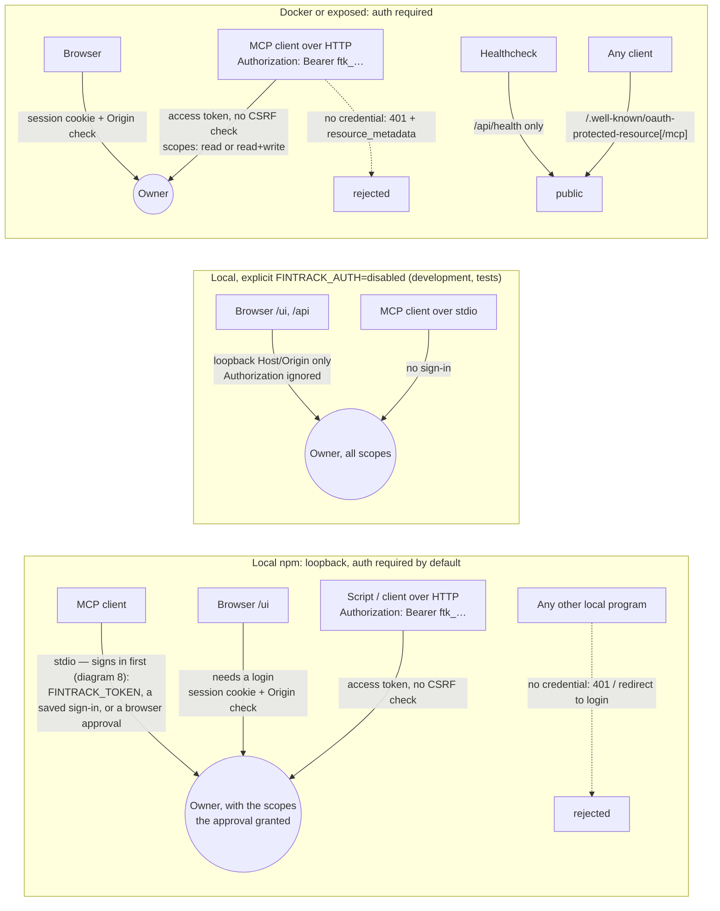

## 7. Your existing database through this phase

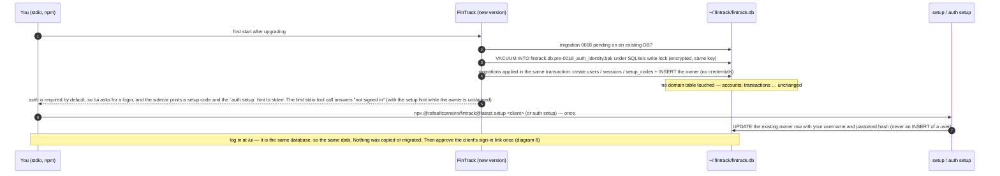

## 8. stdio sign-in (device flow)

ADR-034 §3. Three parties and one database: the stdio **process** (spawned by the client), the person's **browser**, and
FinTrack's HTTP surface (this process's sidecar, or another FinTrack process's on the same port — the grant is a database row, so
either works). Nothing secret travels in a URL or a tool result: the link carries the **user code** only, and the **device
code** that redeems it never leaves the asking process.

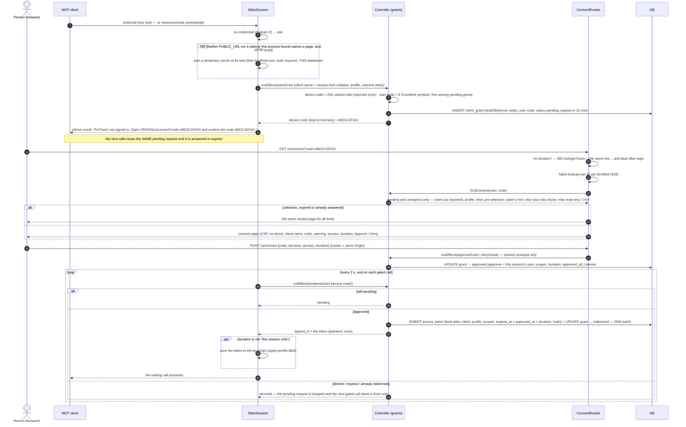

## 9. stdio credential resolution, expiry and re-sign-in

Every gated request (tool call, resource read, prompt get) runs this. `initialize` and the list requests never do. The
credential is re-validated through the same `authenticateToken` the HTTP edge uses, so revocation and expiry take effect on
the **next call**; a failed lookup is "could not check", never a sign-out.

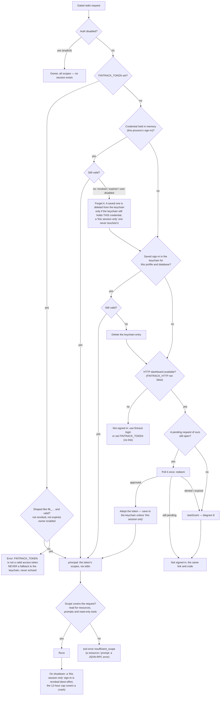

## 10. `fintrack login` and `logout`

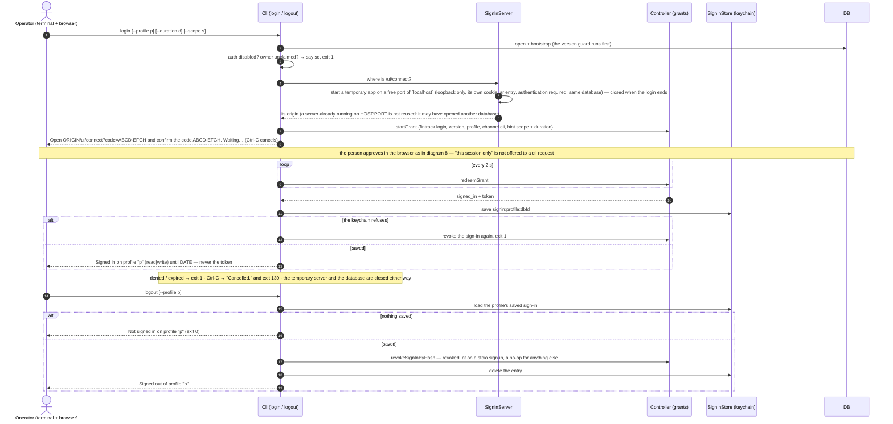

The effects in diagrams 8–10 are executed by the interpreter; what to do next is decided by `nextStep`, shown in diagram 11.

## 11. The sign-in protocol: states and observations

ADR-034. The stdio session and `fintrack login` are two presenters over ONE protocol: `nextStep(state, observation, config)` in
`logic/auth/sign-in-flow.ts` is pure and returns the next state and the effects to run; `src/composition/sign-in/interpreter.ts` runs them and feeds
each answer back as the next observation. The stdio session feeds `requested` (one per gated call), `ticked` (its poll timer while a request
is open) and `closed`; `login` feeds `login_requested` then `ticked`, or `interrupted` after Ctrl-C; `logout` feeds `logout_requested`. For a stdio
session a denied or expired request returns to `idle` (the next gated call asks afresh); for `login` it ends the attempt in a terminal state.

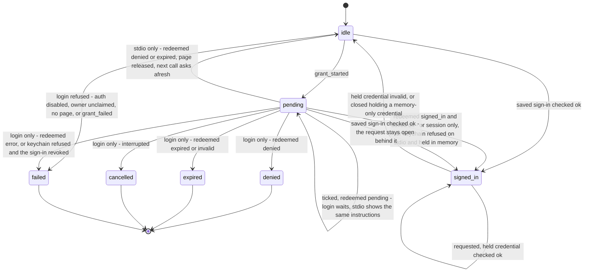

The rules are decided once, in `nextStep`:

| Rule | Where it shows |
|---|---|
| An environment token (`FINTRACK_TOKEN`) is the only credential: a malformed or invalid one is refused, never replaced by the keychain or a new request | `requested` with an env token → `check_credential(env)` only |
| A saved credential found invalid is cleared from the keychain only if the keychain still holds it | `clear_saved_if(token)` — the interpreter loads, compares and clears |
| "This session only" never reaches the keychain | `redeemed(signed_in)` with duration `session` → held `ephemeral`, no `save_credential` |
| A keychain that refuses the sign-in: `login` takes it back, stdio keeps it in memory and revokes it at close | `saved(ok: false)` → `revoke_credential(keychain_refused)` (cli) / `ephemeral` (stdio) |
| An unreadable keychain is "nothing saved" for a session that can ask in the browser, but `logout` must not claim a sign-out it could not check | `load_saved(tolerateUnreadable)` |
| Denied or expired ends the attempt | terminal state (`login`) / back to `idle` (stdio) |
| An unexpected failure is "could not check", never a sign-out | `errored` → `present(cannot_verify)`, state unchanged |

## 12. Invite a user → claim

ADR-033 §5. The admin chooses a username and a role; the person chooses their own password. The only flow that inserts a user is `inviteUser` - claiming only updates that
row. Everything below happens in one write each (`inviteUser`, then `claimInvite`).

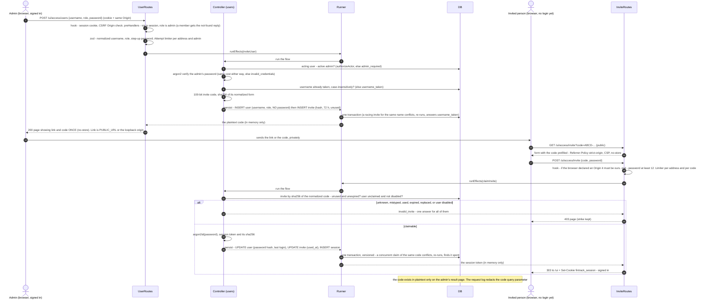

A reissue (`reissueInvite`) is the same first half for an existing user: the previous unclaimed invite is removed in the same batch, and for a user who had claimed one the password is cleared and every session, token
and stdio sign-in ended too (diagram 13 shows that set).

## 13. Disable a user

`disableUser` ends every credential the user holds in the same write that disables them. The guards run first, and the admins left standing are checked (asserted still at the version the guard read, not written) so that two admins disabling each other
cannot both commit.

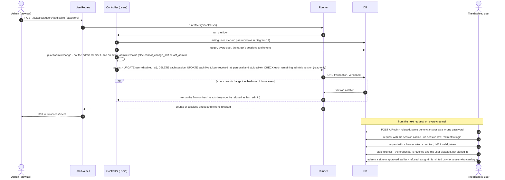

Enabling (`enableUser`) clears `disabled_at` and nothing else: the person logs in again and signs their clients in again; no earlier credential is revived.
