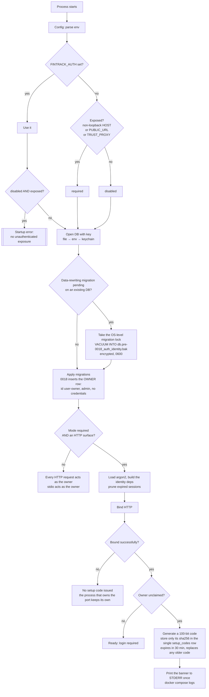
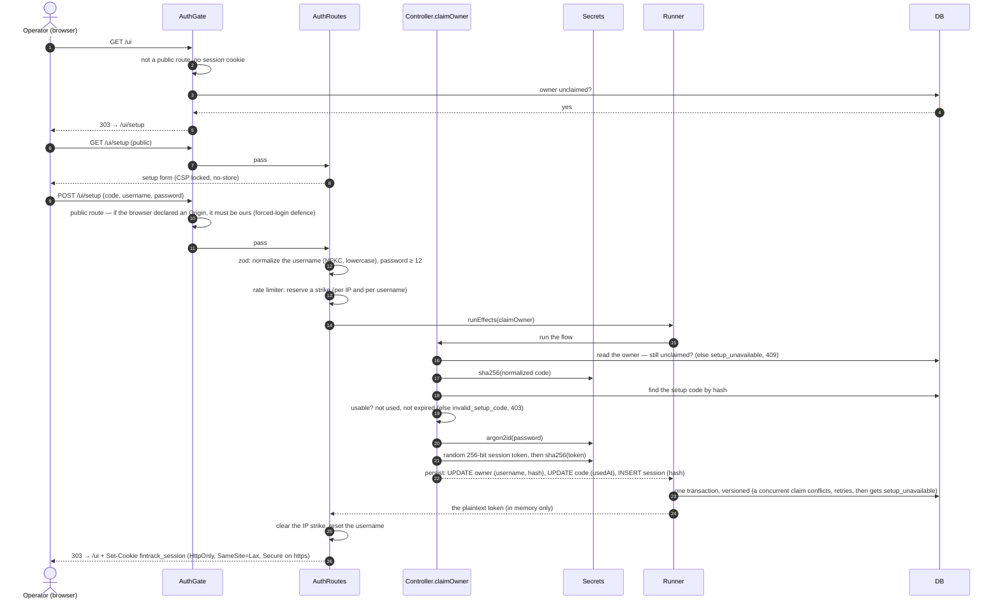
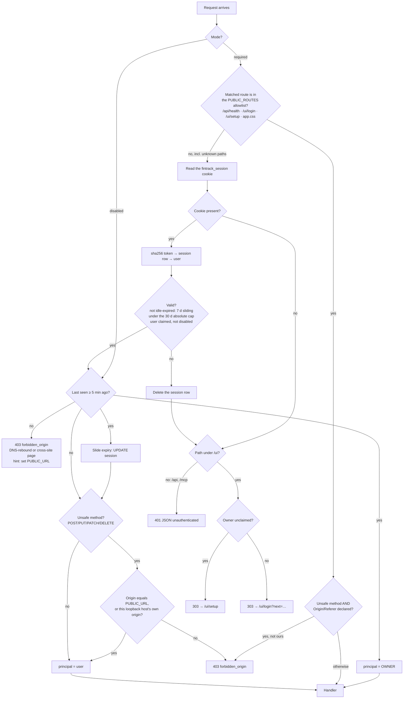
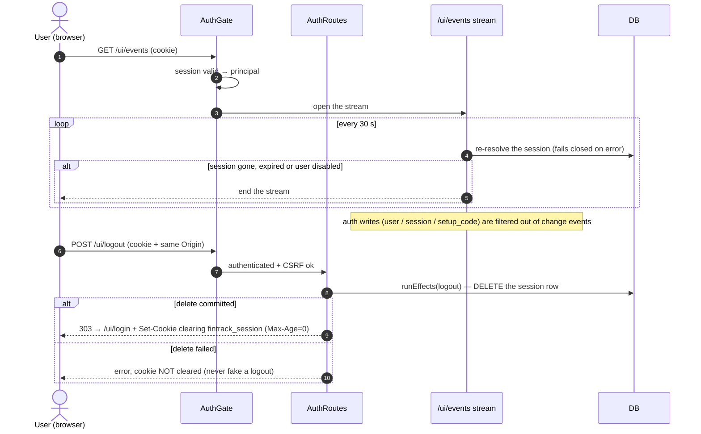
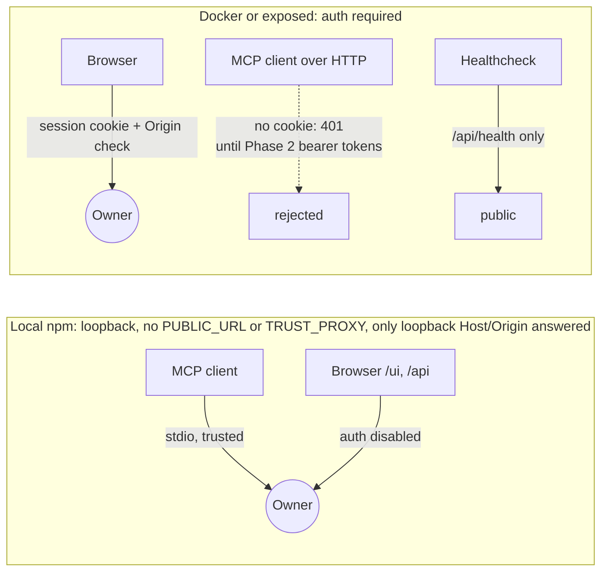
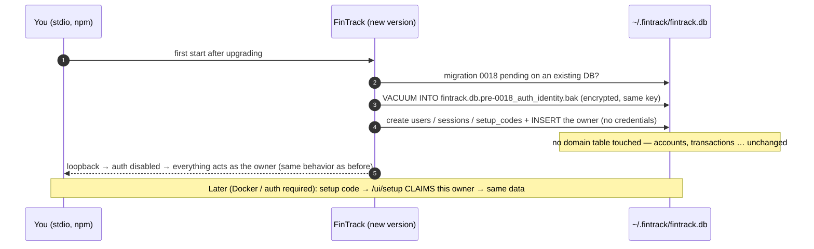

# Authentication flows (ADR-033 Phase 1)

These diagrams show the flows as built: who takes part in each one and what happens at each step.
The operator guide is [`auth.md`](auth.md); the decision record is
[`adr/033-authentication-and-multi-user.md`](adr/033-authentication-and-multi-user.md).

**Participants** (each name matches a source file):

| Participant | Where | Role |
|---|---|---|
| Config | `src/config.ts` | Decides the auth mode from `HOST` / `PUBLIC_URL` / `TRUST_PROXY` / `FINTRACK_AUTH` |
| Bootstrap | `src/diplomat/db/bootstrap.ts`, `safetyCopy.ts`, `migrationLock.ts` | Migrations, the owner row, the pre-migration backup |
| AuthRuntime | `src/authRuntime.ts` | Builds the identity deps, prunes sessions, issues and prints the setup code |
| AuthGate | `src/diplomat/http/hooks/auth.ts` (decisions in `src/logic/auth.ts`) | The `onRequest` hook: the loopback Host/Origin guard (auth disabled), the public allowlist, session resolution, the CSRF check, redirects |
| AuthRoutes | `src/diplomat/http/routes/auth.ts` | `/ui/setup`, `/ui/login`, `/ui/logout`: form parsing, rate limiting, cookies |
| Controller | `src/controllers/auth.ts` | `issueSetupCode`, `claimOwner`, `login`, `logout`, `authenticate`; returns `{ persist, response }` |
| Logic | `src/logic/auth.ts` | Pure rules: expiry, the sliding window, "can log in", origin comparison |
| Secrets | `src/diplomat/auth/credentials.ts` | argon2id, CSPRNG tokens and codes, sha256 |
| Runner | `@rfc0/effect-runner` via `runEffects` | Applies the persistables in one transaction (optimistic versions, retries) |
| DB | `users`, `sessions`, `setup_codes` | Stores only hashes, never a token or code in plaintext |

---

## 1. Startup: which mode, the owner row, and the setup code

## 2. First-time setup: claiming the owner

## 3. Login

## 4. Every authenticated request (the auth hook)

## 5. Logout and live dashboards (SSE)

## 6. Who acts as whom, per transport

## 7. Your existing database through this phase

