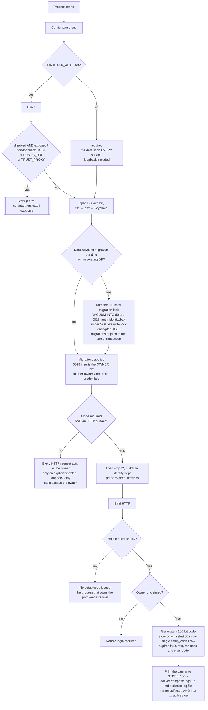
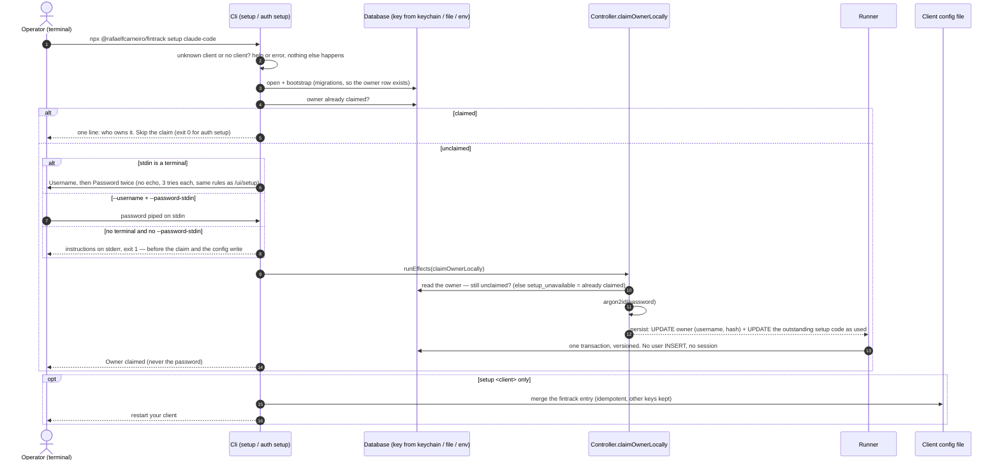
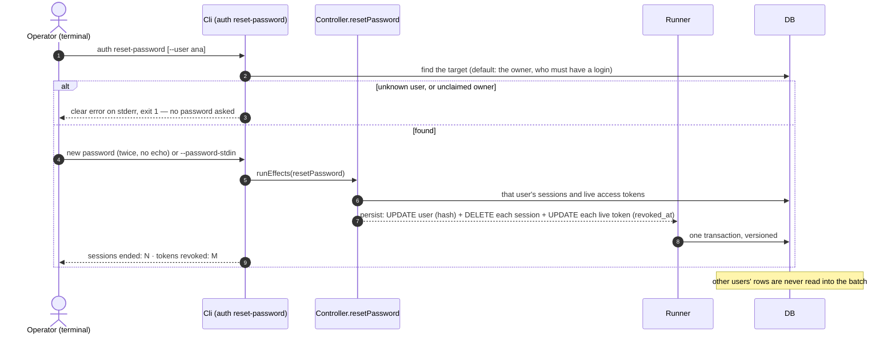
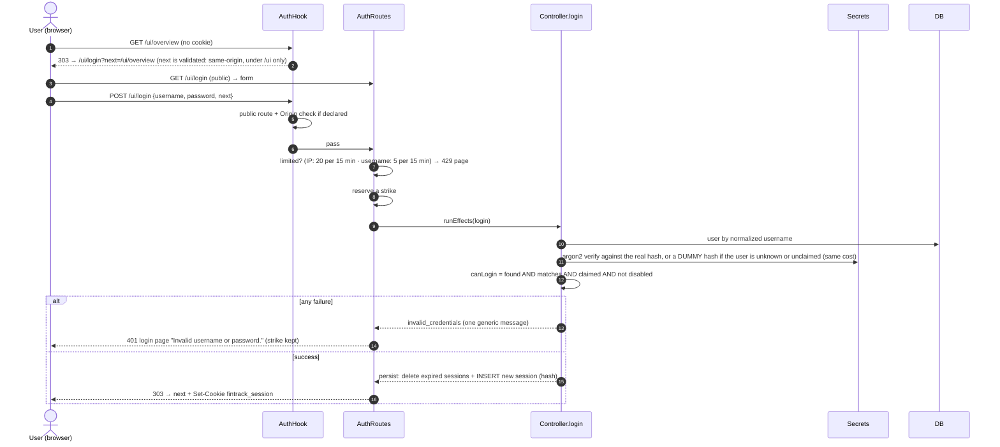
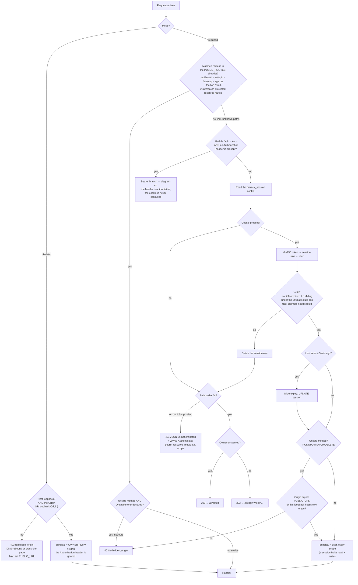
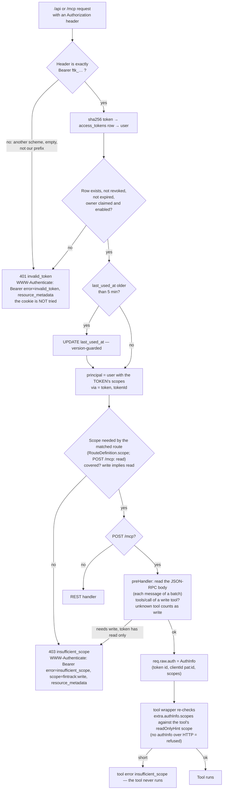
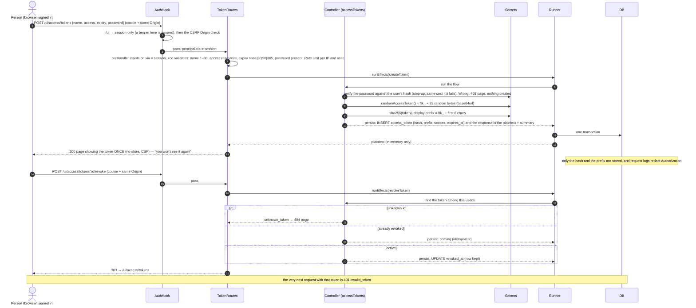
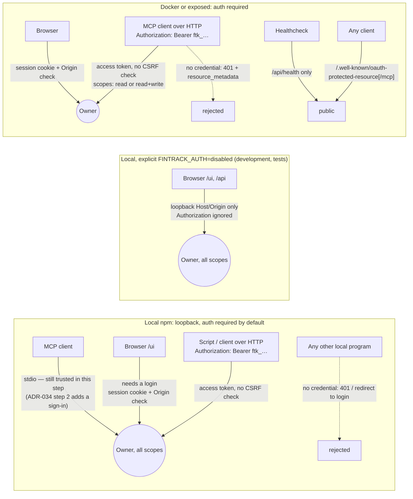
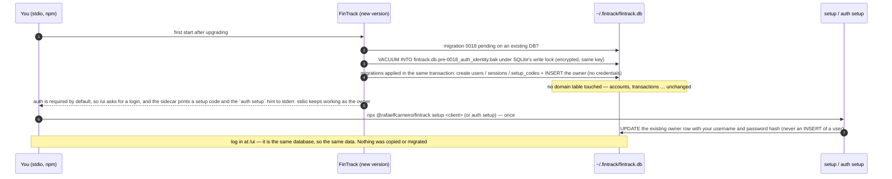

# Authentication flows (ADR-033 Phases 1–2, ADR-034 step 1)

These diagrams show the flows as built: who takes part in each one and what happens at each step.
The operator guide is [`auth.md`](auth.md); the decision record is
[`adr/033-authentication-and-multi-user.md`](adr/033-authentication-and-multi-user.md) and
[`adr/034-local-auth-and-stdio-sign-in.md`](adr/034-local-auth-and-stdio-sign-in.md).

**Participants** (each name matches a source file):

| Participant | Where | Role |
|---|---|---|
| Config | `src/config.ts` | Reads `FINTRACK_AUTH` (default `required`) and refuses `disabled` on an exposed instance (`HOST` / `PUBLIC_URL` / `TRUST_PROXY`) |
| Bootstrap | `src/diplomat/db/bootstrap.ts`, `safetyCopy.ts`, `migrationLock.ts` | Migrations, the owner row, the pre-migration backup |
| AuthRuntime | `src/authRuntime.ts` | Builds the identity deps (shared with the CLI), prunes sessions, issues and prints the setup code |
| Cli | `src/cli.ts`, `src/authCli.ts`, `src/diplomat/cli/{prompt,terminal}.ts` | `fintrack setup [client]`, `fintrack auth setup`, `fintrack auth reset-password`: opens the database like the server (no HTTP, no stdio), prompts with no echo, runs the controller flows |
| AuthHook | `src/diplomat/http/hooks/auth.ts` — `registerAuthHook` (decisions in `src/logic/auth.ts`) | The `onRequest` hook: the loopback Host/Origin guard (auth disabled), the public allowlist, credential precedence (bearer vs. cookie), session/token resolution, the CSRF check, the route-scope check, challenges and redirects |
| Bearer | `src/diplomat/http/bearer.ts` | Builds the `WWW-Authenticate` response (`logic/auth.ts`'s `bearerChallenge`; only the origin is resolved at the edge) — shared by the hook and the MCP route |
| AuthRoutes | `src/diplomat/http/routes/auth.ts` | `/ui/setup`, `/ui/login`, `/ui/logout`: form parsing, rate limiting, cookies |
| TokenRoutes | `src/diplomat/http/routes/tokens.ts` | `/ui/access/tokens`, `/ui/access/tokens/:id/revoke`: session-only token pages |
| WellKnown | `src/diplomat/http/routes/wellKnown.ts` | The two Protected Resource Metadata (RFC 9728) routes |
| McpRoute | `src/diplomat/mcp/route.ts`, `scopes.ts` | `POST /mcp`: per-tool scope pre-check on the JSON-RPC body, `req.auth` for the transport, per-tool re-check |
| Controller | `src/controllers/auth.ts`, `src/controllers/accessTokens.ts` | `issueSetupCode`, `claimOwner`, `claimOwnerLocally`, `resetPassword`, `login`, `logout`, `authenticate`; `createToken`, `listTokens`, `revokeToken`, `authenticateToken`; returns `{ persist, response }` |
| Logic | `src/logic/auth.ts` | Pure rules: expiry, the sliding window, "can log in", origin comparison, scopes, the token verdict, credential parsing, challenges, the metadata document |
| Secrets | `src/diplomat/auth/credentials.ts` | argon2id, CSPRNG session tokens, access tokens (`ftk_…`) and codes, sha256 |
| Runner | `@rfc0/effect-runner` via `runEffects` | Applies the persistables in one transaction (optimistic versions, retries) |
| DB | `users`, `sessions`, `setup_codes`, `access_tokens` | Stores only hashes, never a token or code in plaintext |

---

## 1. Startup: which mode, the owner row, and the setup code

## 2. First-time setup: claiming the owner

## 2b. First setup from the terminal

`fintrack setup <client>` and `fintrack auth setup` (ADR-034 §5). The CLI is a process of its own: it opens the database
with the same key resolution and migrations as the server, but starts neither HTTP nor stdio. Nothing here is typed into a
chat, and no sign-in link or setup code is involved.

### Reset a password

## 3. Login

## 4. Every authenticated request (the auth hook)

## 4b. Bearer token request (REST / MCP)

Precedence → verify → scope → handler / 401 / 403. A bearer carries no ambient credential, so there is **no CSRF check**.
`/ui` never takes this path: a bearer there is "no credential" and gets the login redirect.

## 4c. Create / revoke a token

## 5. Logout and live dashboards (SSE)

## 6. Who acts as whom, per transport

## 7. Your existing database through this phase

